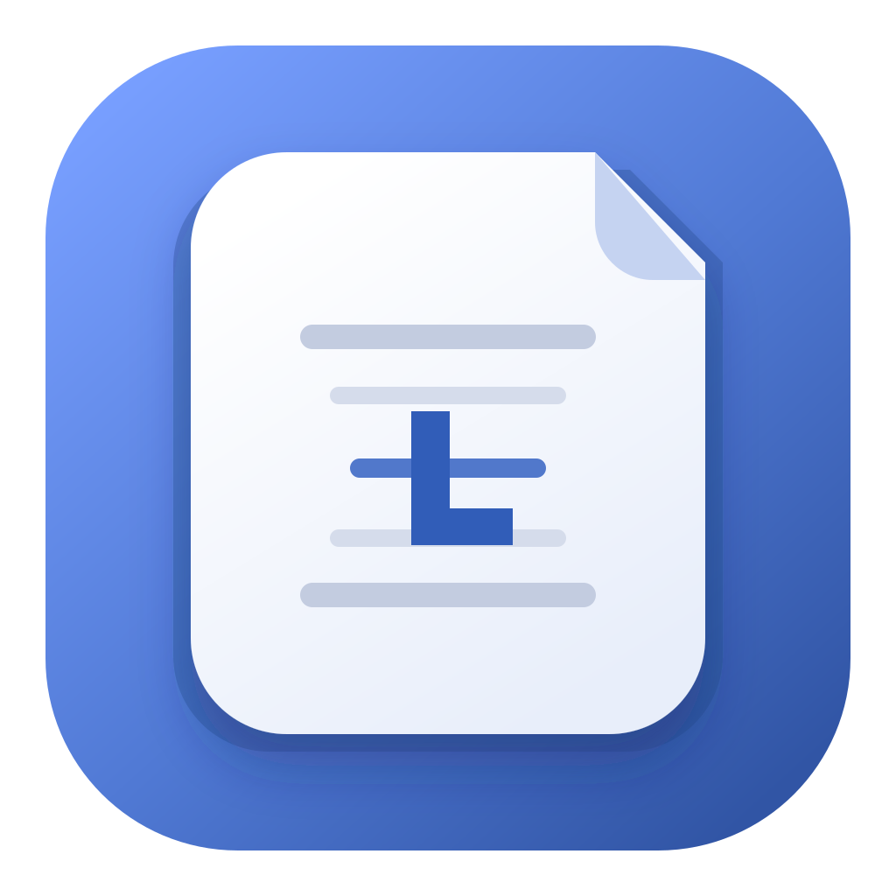
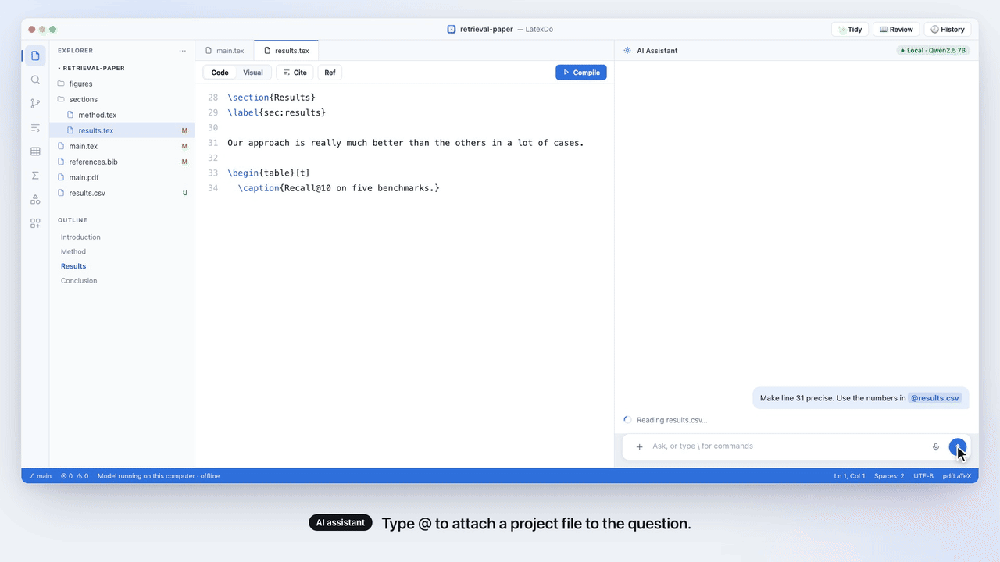
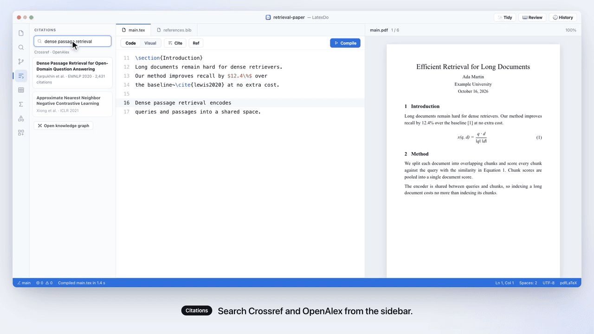
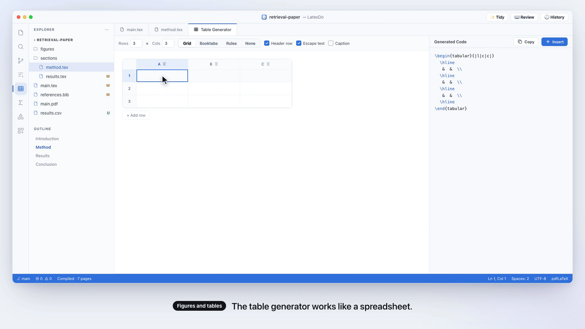
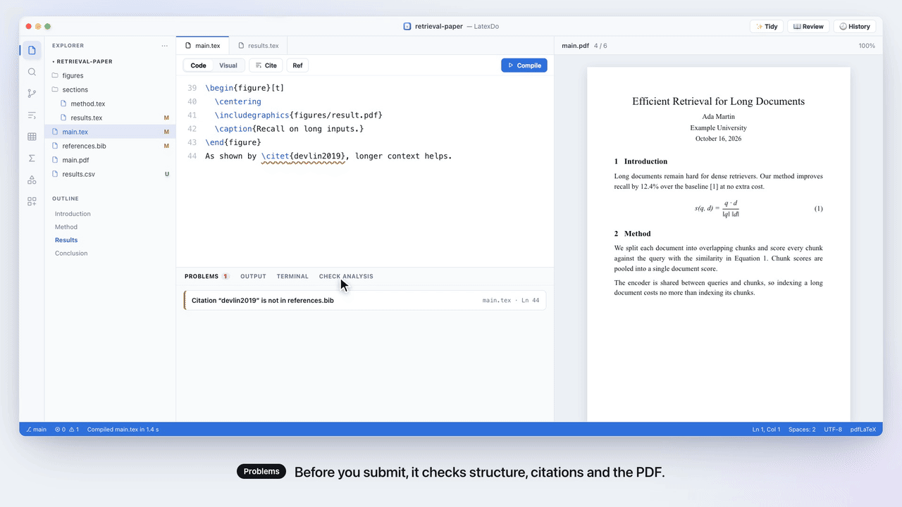

<p align="center">
  
</p>

<h1 align="center">LatexDo</h1>

<p align="center">
  <strong>The LaTeX editor that writes, compiles, cites and answers reviewers with you.</strong><br />
  Free, open source, and on your own computer.
</p>

<p align="center">
  <a href="https://latexdo.org/downloads/"></a>
  <a href="LICENSE"></a>
  <a href="CONTRIBUTING.md#tests"></a>
</p>

<p align="center">
  <a href="https://latexdo.org/downloads/">Download</a> ·
  <a href="https://latexdo.org/docs/">Documentation</a> ·
  <a href="https://latexdo.org/">Website</a> ·
  <a href="https://github.com/latexdo/latexdo-desktop/issues">Report a bug</a>
</p>

<p align="center">
  
</p>

## Why LatexDo

- **Source and PDF side by side.** Click a sentence in the PDF to jump to its line, and back.
- **Errors in plain language.** What went wrong, where, and a one-click fix when there is one.
- **An AI assistant you control.** Run it on your computer, with Ollama, or with your own provider. Nothing changes until you approve it.
- **Citations that connect.** Search Crossref and OpenAlex, insert `\cite`, and see your references as a graph.
- **Review and rebuttal.** Annotate PDFs, answer each reviewer, and get a response letter.
- **Your files stay yours.** Projects are ordinary folders. No account, no upload.

<p align="center">
  <br />
  <sub><b>AI edits wait for you.</b> Every change is a diff you approve or reject.</sub>
</p>

<p align="center">
  <br />
  <sub><b>Citations.</b> Search papers, cite them, and explore how they connect.</sub>
</p>

<p align="center">
  <br />
  <sub><b>Tables like a spreadsheet.</b> Type or paste cells, get clean LaTeX.</sub>
</p>

<p align="center">
  <br />
  <sub><b>Ready to submit.</b> Structure, citations and the PDF are checked for you.</sub>
</p>

## Install

Download LatexDo for **macOS**, **Windows** or **Linux** from
[latexdo.org/downloads](https://latexdo.org/downloads/). To compile, LatexDo uses
the TeX distribution on your computer (MacTeX, MiKTeX or TeX Live). If you have
none, the setup assistant installs one.

New to LatexDo? Start with the [documentation](https://latexdo.org/docs/).

## Build from source

You need [Node.js](https://nodejs.org/) 22 or newer.

```sh
git clone https://github.com/latexdo/latexdo-desktop.git
cd latexdo-desktop
npm install
npm run dev
```

`npm test` runs the tests and `npm run dist` builds the installers. See
[CONTRIBUTING.md](CONTRIBUTING.md) for all commands, how releases work, and how to
send a change.

## License

[MIT](LICENSE). LatexDo is built by [LATEXDO](https://latexdo.org/about/), a French
nonprofit association.
